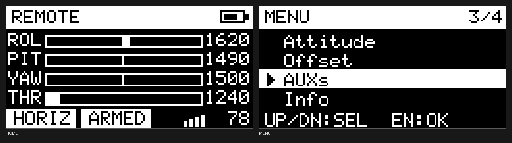
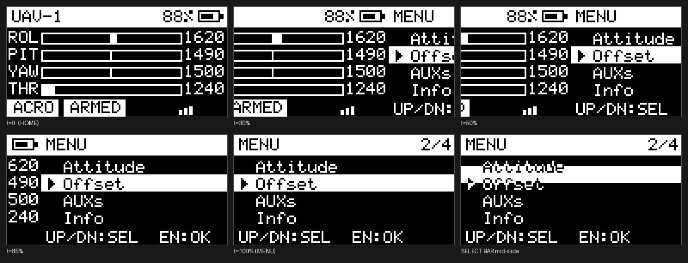

# F103 遥控器固件（Remote TX）

基于 **STM32F103C8T6** 的航模遥控器发射端固件。FreeRTOS 三任务架构，128×64 OLED 图形界面带页面滑动 / 抖动淡入 / 弹框动画，通过 USART1 与飞控（或接收机）双向通信：上行 32 字节遥控帧，下行 24 字节遥测帧。



---

## 功能特性

| 功能 | 说明 |
|---|---|
| 12 路通道 | Roll / Pitch / Throttle / Yaw + Arm + Mode + AUX3~AUX8，外加 Roll/Pitch 微调，全部输出 1000~2000 |
| 62.5 Hz 上行 | InputTask 每 16 ms 组一帧，32 字节，DMA 发送 |
| 遥测下行 | 24 字节：姿态（float）、油门、电量、RSSI；DMA + IDLE 断帧 |
| 图形界面 | 7 个页面、1bpp 帧缓冲、按页差异刷新（只发变化的页） |
| 动画 | 页面滑动 180 ms、选择条滑动 120 ms、开机抖动淡入 1000 ms、提示框进出场 |
| 安全联锁 | 油门未归零时拒绝解锁（切到 2000），并在屏幕上弹框提示 |
| 状态指示 | 3 个 LED 分工：故障/低电、飞控电量、链路丢失 |
| 参数可调 | 菜单里直接改 AUX3~8 和 Roll/Pitch 微调，带长按连加/连减 |

---

## 硬件平台

| 项目 | 参数 |
|---|---|
| MCU | STM32F103C8T6，Cortex-M3，72 MHz，64 KB Flash / 20 KB RAM |
| 时钟 | HSE 8 MHz × 9 = 72 MHz；APB1 36 MHz，APB2 72 MHz，ADC 12 MHz |
| 显示 | SSD1306 128×64 单色 OLED，SPI1（重映射 PB3/PB5），9 MHz，DMA 刷屏 |
| 摇杆 | 3 个电位器（Roll/Pitch/Throttle），ADC1 扫描 + DMA 自动搬运 |
| 按键 | 4 个（UP/DOWN/ENTER/BACK），软件消抖 + 长按连发 |
| 拨杆 | 2 个三档开关（解锁、飞行模式） |
| 电池检测 | ADC 采样分压后的电池电压，换算成 0~100% |

---

## 快速开始

### 编译

用 **Keil MDK 5** 打开 `MDK-ARM/F103.uvprojx`，目标 `F103`，直接 Build：

- 编译器：ARMCC V5.06（AC5），`-O0`，MicroLIB
- 器件：STM32F103C8
- 构建产物在 `MDK-ARM/F103/`（已被 `.gitignore` 排除，不进版本库）

命令行构建（Keil 未打开时）：

```powershell
UV4.exe -b MDK-ARM\F103.uvprojx -j0 -o build.log
```

> Keil IDE 开着时再跑 `UV4 -b` 会因工程被占用而崩溃（`0xC0000409`），请先关闭 IDE。

### 烧录

`.hex` / `.axf` 在 `MDK-ARM/F103/` 下，用 ST-Link（SWD）下载即可。当前固件约 **48.0 KB**，占 64 KB Flash 的 **75%**。

### 外设配置

根目录的 `F103.ioc` 是 STM32CubeMX 工程，可用于重新生成初始化代码（注意：`Core/Src/ui_*`、`menu.c`、`key.c` 是手写代码，重新生成时不要覆盖）。

---

## 系统架构

### 任务划分

| 任务 | 优先级 | 栈 | 触发方式 | 职责 |
|---|---|---|---|---|
| `UartTxTask` | High (40) | 512 B | 事件驱动（阻塞在队列上） | 发 TX 帧、取 RX 帧、驱动指示灯 |
| `InputTask` | Normal (24) | 512 B | `vTaskDelayUntil` 16 ms | ADC 采样与映射、按键扫描、组帧入队 |
| `DisplayTask` | Low (8) | 1024 B | `vTaskDelayUntil` 20 ms / 14 ms | 渲染 UI、差异刷屏 |

三个任务都有明确的阻塞点，没有忙等：`UartTxTask` 阻塞在 `osMessageQueueGet(..., osWaitForever)`，另外两个阻塞在 `vTaskDelayUntil`。UI 在动画期间把帧周期从 20 ms 提到 14 ms（50 → 71 fps）。

### 任务间通信

| 对象 | 规格 | 方向 |
|---|---|---|
| `TxFrameQueue` | 3 × 32 B | InputTask → UartTxTask |
| `RxFrameQueue` | 4 × 24 B | USART1 中断回调 → UartTxTask |
| `KeyEventQueue` | 8 × 1 B | InputTask → DisplayTask |
| `settings_mutex` | — | 保护菜单可改参数（AUX3~8、微调） |
| `frame_mutex` | — | 保护"最新帧快照"，避免 32/24 字节结构体被读到半新半旧 |

### 数据流

```
   ┌─────────────┐
   │  InputTask  │ 16 ms 周期，ADC1 五通道由 DMA 自动搬运
   └──────┬──────┘
          │ TxFrameQueue  3 × 32 B
          ▼
   ┌─────────────┐   USART1 TX（DMA）    ┌──────────────┐
   │  UartTxTask │ ────────────────────► │ 飞控 / 接收机 │
   │             │ ◄──────────────────── └──────────────┘
   └──────┬──────┘   USART1 RX（DMA + IDLE）
          │          收到后立刻写入 RxFrameQueue，再在任务里取最新一帧
          │ frame_mutex（最新帧快照）
          ▼
   ┌─────────────┐  ◄──── KeyEventQueue  8 × 1 B  ◄──── InputTask
   │ DisplayTask │ 20 ms（动画期间 14 ms）
   └──────┬──────┘
          │ OLED_FlushWindow（SPI1 + DMA，只发变化的页）
          ▼
      SSD1306 128×64
```

---

## 通信协议

串口参数：**115200 / 8N1**，小端字节序。

### 上行：遥控帧（32 字节，16 × uint16）

| 偏移 | 字段 | 取值 | 说明 |
|---:|---|---|---|
| 0 | `head` | `0x4020` | 帧头 |
| 2 | `roll` | 1000~2000 | 横滚 |
| 4 | `pitch` | 1000~2000 | 俯仰 |
| 6 | `throttle` | 1000~2000 | 油门 |
| 8 | `yaw` | 1000~2000 | 偏航（按键微调） |
| 10 | `arm` | 1000 / 1500 / 2000 | 上锁 / 中位 / 解锁 |
| 12 | `mode` | 1000 / 1500 / 2000 | 飞行模式 |
| 14~24 | `aux3`~`aux8` | 1000~2000 | 6 个辅助通道 |
| 26 | `roll_offset` | 1000~2000 | 横滚微调 |
| 28 | `pitch_offset` | 1000~2000 | 俯仰微调 |
| 30 | `checksum` | — | `0xFFFF - sum(前 30 字节)` |

### 下行：遥测帧（24 字节）

| 偏移 | 字段 | 类型 | 说明 |
|---:|---|---|---|
| 0 | `head` | uint16 | `0x4020` |
| 2 | `bat` | uint16 | 飞控电池百分比 0~100 |
| 4 | `roll` | float | 姿态角 |
| 8 | `pitch` | float | |
| 12 | `yaw` | float | |
| 16 | `altitude` | float | 高度 |
| 20 | `rssi` | uint16 | 信号强度 0~100 |
| 22 | `checksum` | uint16 | `0xFFFF - sum(前 22 字节)` |

### 接收实现

`HAL_UARTEx_ReceiveToIdle_DMA` 一次性挂 24 字节，靠 **IDLE 中断**判断一帧结束：

- 长度正好 24 且帧头、校验都通过 → 投递到 `RxFrameQueue`
- 无论成功与否都立刻重新挂载接收（`Protocol_Start_Receive`）
- 超过 `RX_LINK_TIMEOUT_MS`（1000 ms）没收到任何帧 → 判定链路断开（UI 显示归零、蓝灯慢闪），并重启接收通道

---

## 摇杆标定与联锁

### ADC 映射

5 个通道由 DMA 循环搬运到 `adc_buf[5]`：

| 索引 | ADC 通道 | 引脚 | 用途 |
|---:|---|---|---|
| 0 | CH9 | PB1 | Roll |
| 1 | CH8 | PB0 | Pitch |
| 2 | CH1 | PA1 | Throttle |
| 3 | CH2 | PA2 | 未使用（早期版本的 Yaw 电位器） |
| 4 | CH5 | PA5 | 电池电压 |

三点标定，中点两侧各一条直线：

```c
#define ROLL_ADC_CENTER   1986   /* 摇杆回中 */
#define ROLL_ADC_MIN      0      /* 推到下极限 */
#define ROLL_ADC_MAX      4025   /* 推到上极限 */
```

- 中点 → 1500，两端分别 → 1000 / 2000，**三个点都精确命中**
- 两端各有 6 个 ADC 计数的**吸附区**（`AXIS_EDGE_SNAP`），避免满偏时输出在 1999/2000 之间抖动
- 除法做四舍五入，中间位置误差 ≤ 1
- 中点附近保留 2 个单位的死区，静止时数值不跳

> 如果换了摇杆或电位器，只需改这三个常数。规律：输出差 1 个单位 ≈ 调 4 个 ADC 计数。

### 解锁联锁

解锁开关拨到 ARMED 位时，**只有油门在最低位**（`throttle <= 1010`）才允许把 `arm` 切到 2000；否则保持原值（1000/1500），并在屏幕上弹出提示框 2 秒。

- 上锁/中位不受任何条件限制（紧急上锁永远立即生效）
- 提示仅在"拨动那一下"触发（边沿检测），不会在飞行中一直糊在屏幕上

---

## 用户界面

### 页面

| 页面 | 内容 |
|---|---|
| `PAGE_HOME` | 4 路通道条 + 数值、模式/锁定 chip、RSSI 格 + 数值、电池图标 |
| `PAGE_MENU` | 主菜单：Attitude / Offset / AUXs / Info |
| `PAGE_ATTITUDE` | 姿态角、高度、链路状态、RSSI |
| `PAGE_OFFSET` | Roll / Pitch 微调 |
| `PAGE_ANGLE_PID` | AUX3~5 编辑 |
| `PAGE_RATE_PID` | AUX6~8 编辑 |
| `PAGE_INFO` | 固件版本、屏幕型号、运行时间 |



### 渲染管线

```
page_render()  只负责往帧缓冲画
   ↓
ui_begin()     清帧缓冲（1024 B）
   ↓
[过渡动画：两页分别带偏移画进同一块帧缓冲，越界自动裁剪]
   ↓
ui_flush()     逐页算 FNV-1a 哈希 → 只把变化的连续页区间用一次 DMA 发出去
   ↓
SSD1306        水平寻址模式下连续写
```

- 帧缓冲：`uint8_t ui_fb[8][128]`，一个字节 = 纵向 8 个像素，与 SSD1306 的页结构天然对应
- 差异检测：每页 32 位 FNV-1a 哈希，整帧发送成功后提交，失败则下一帧重发
- 典型负载：静态页几乎 0 流量；全屏 1024 字节 DMA 约 0.9 ms

### 动画

| 动画 | 时长 | 实现 |
|---|---|---|
| 页面滑动 | 180 ms | 两页带全局偏移画进同一帧缓冲 |
| 选择条滑动 | 120 ms | 位置插值 + `ui_xor_rect` 反相覆盖，文字不需重画 |
| 开机淡入 | 1000 ms | 4×4 Bayer 抖动遮罩（`ui_dither_fade`），1bpp 上模拟透明度 |
| 解锁提示框 | 2 s + 180/150 ms | 从屏幕上缘滑入、停留、滑出 |

全部动画用整数缓动 `ui_ease_out`，无浮点、无额外帧缓冲。

### 代码结构

| 文件 | 职责 |
|---|---|
| `ui_core.c` | 帧缓冲、基本图元、字库渲染、差异刷新、抖动淡入 |
| `ui_widgets.c` | 标题条、chip、进度条、电池、RSSI、列表行 |
| `ui_icons.c` | 8×8 图标 |
| `ui_home.c` / `ui_menu.c` / `ui_edit.c` / `ui_info.c` / `ui_attitude.c` | 各页面（只画，不管帧生命周期） |
| `ui_anim.c` | 动画计时与缓动 |
| `menu.c` | 页面状态机、按键分发、过渡合成、帧生命周期 |
| `oled.c` | SSD1306 驱动（命令序列、窗口、DMA 刷屏、错误恢复） |

---

## 引脚分配

| 功能 | 引脚 | 备注 |
|---|---|---|
| OLED SCLK | PB3 | SPI1 重映射 |
| OLED MOSI | PB5 | SPI1 重映射 |
| OLED CS | PA15 | 低有效 |
| OLED DC | PA0 | 高 = 数据 |
| OLED RST | PB4 | 需关闭 JTAG（保留 SWD） |
| USART1 TX | PB6 | 115200 |
| USART1 RX | PB7 | DMA + IDLE |
| 按键 UP / DOWN | PB8 / PA10 | 低有效 |
| 按键 ENTER / BACK | PB9 / PA9 | 低有效 |
| 解锁开关 | PA3 / PA4 | 三档 |
| 模式开关 | PC13 / PC14 | 三档 |
| 红灯 | PA7 | 低电平点亮 |
| 绿灯 | PA6 | 低电平点亮 |
| 蓝灯 | PC15 | 低电平点亮 |

---

## 按键与指示灯

### 按键

| 按键 | 单击 | 长按（≥500 ms，之后每 100 ms，仅在编辑态生效） |
|---|---|---|
| UP | 上移光标 / +1 | +10 |
| DOWN | 下移光标 / −1 | −10 |
| ENTER | 进入菜单 / 进入编辑 | — |
| BACK | 返回 / 退出编辑 | — |

消抖方式：连续两次采样一致才认，没有阻塞延时。

### LED 语义

| 状态 | 红灯 | 绿灯 | 蓝灯 |
|---|---|---|---|
| 一切正常 | 灭 | 灭 | 灭 |
| 飞控电量 < 10%（遥测） | 灭 | **常亮** | 灭 |
| 遥测链路丢失 | 灭 | 灭 | **1 Hz 闪烁** |
| 遥控器自身电池耗尽 | **常亮** | 灭 | — |
| 固件致命错误（堆/栈溢出） | **常亮** | — | — |

---

## 资源占用

| 项目 | 占用 | 比例 |
|---|---|---|
| Flash（Code + RO + RW） | 48.1 KB | 75% / 64 KB |
| RAM（RW + ZI） | 17.2 KB | 86% / 20 KB |
| FreeRTOS heap 已用 | ≈ 3 KB | 30% / 10 KB |

RAM 里最大的一块是 8 页 × 128 字节的帧缓冲（1024 B）加上 FreeRTOS 堆（10240 B）。

---

## 目录结构

```
├─ Core/
│  ├─ Inc/            头文件（协议、菜单、UI、驱动）
│  └─ Src/            应用与驱动实现
│     ├─ main.c           时钟与外设初始化
│     ├─ freertos.c       任务、队列、摇杆映射、联锁、LED
│     ├─ protocol.c       帧解析、校验、快照锁、参数管理
│     ├─ menu.c           页面状态机、按键分发、动画合成
│     ├─ ui_*.c           UI 框架与各页面
│     ├─ oled.c           SSD1306 驱动
│     └─ key.c            按键消抖与长按
├─ Drivers/           STM32 HAL 与 CMSIS（CubeMX 生成）
├─ Middlewares/       FreeRTOS 10.3.1 + CMSIS-RTOS2
├─ MDK-ARM/           Keil 工程、启动文件（构建产物已被忽略）
├─ docs/              UI 预览图
└─ F103.ioc           STM32CubeMX 工程
```

---

## License

本项目基于 MIT 协议开源。
